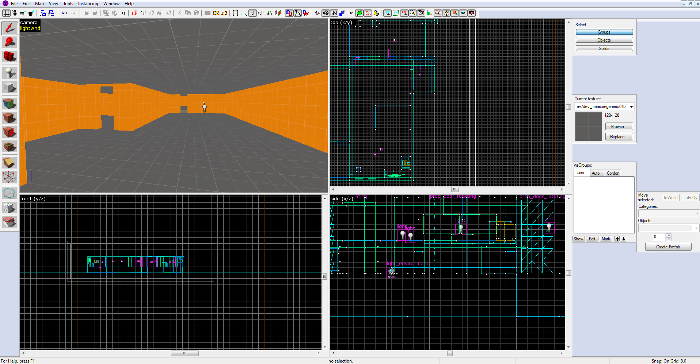
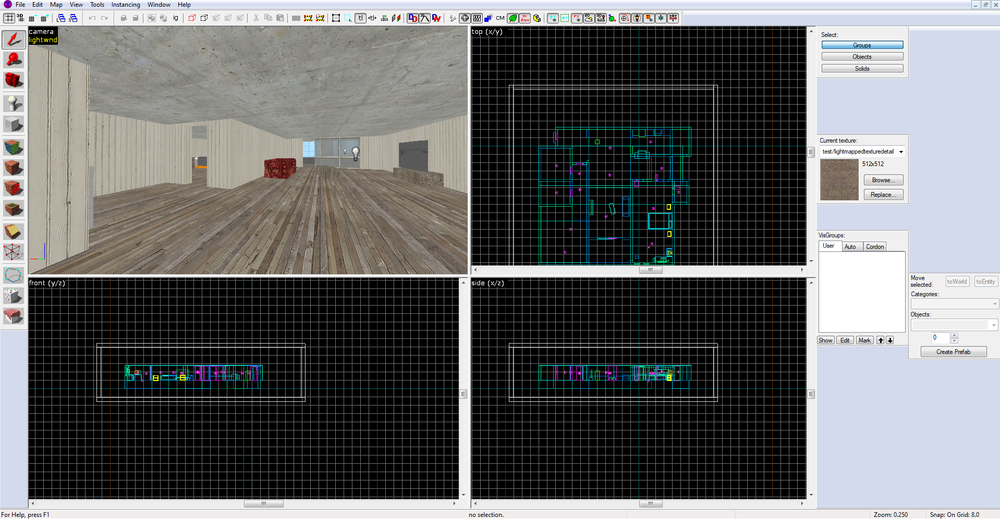
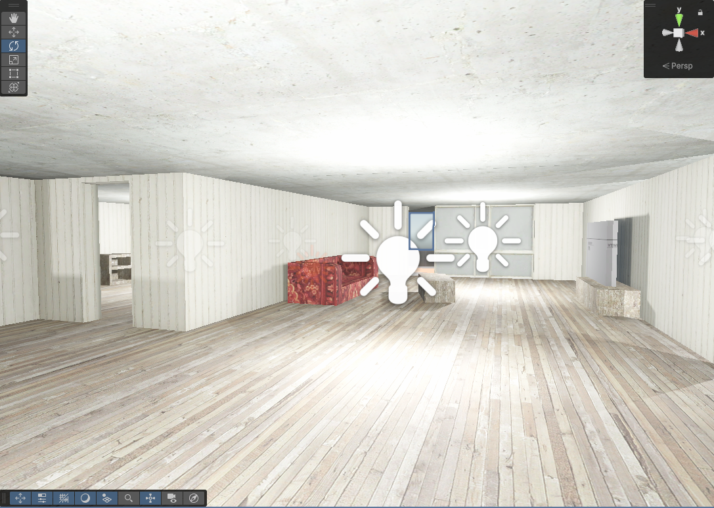
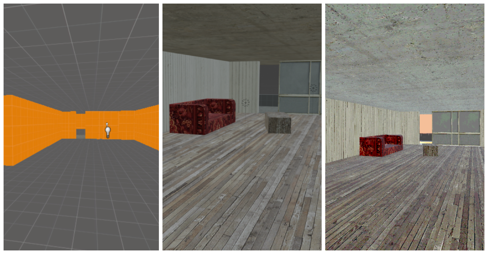

When I first started making maps, it was in the **Hammer Editor** for the Source Engine. Hammer was my creative playground — fast, simple, and deeply familiar. It’s a tool built for a very specific purpose: making levels for games like *Half-Life 2*, *Counter-Strike: Source*, and *Portal*.  

For years, I assumed those skills would stay locked inside those games forever.

Recently, while working in **Unity**, I had a realization: the tools we know best can still serve us in modern workflows. In this post, I’ll walk through how to take a map made in Hammer, bring it into **Blender** using the **Plumber** plugin, export it as FBX, and import it into Unity.

More importantly, I’ll explain *why* it’s worth embracing old tools alongside new ones.

---

## Why Start in Hammer?

If you’ve spent time modding Source games, you probably have strong muscle memory for Hammer. You know how units feel, how to align brushes, and how to block out a layout quickly and intuitively.

In many cases, I can prototype a level layout faster in Hammer than I can in Unity or Blender — even though those tools are more modern and powerful.

Instead of fighting a new toolset at the earliest stage, you can leverage what you already know. That means focusing on the creative part of level design instead of UI friction.

---

## The Workflow

Here’s the full pipeline, step by step.

---

## Step 1: Build a Map in Hammer

Start by creating a simple level using the Source SDK’s Hammer Editor. Keep it clean and focused on layout rather than detail.

When you’re finished, save the map as a `.VMF` file (Valve Map Format).

---

## Step 2: Import into Blender with Plumber

Instead of converting files externally, use **Plumber**, a Blender add-on that directly reads VMF and BSP files. It imports them as structured 3D scenes, including materials and textures.

**How to use Plumber:**

1. Install Plumber via Blender’s Add-on preferences.
2. Go to **File → Import → Source Engine VMF/BSP**.
3. Select your `.VMF` file and import it.

---

## Step 3: Unpack Textures for Export

After import, Blender links Source textures internally. Before exporting to Unity, you’ll want those textures saved to disk.

In Blender:

1. Go to **File → External Data → Unpack Resources**
2. Choose **Unpack All Into Files**

This extracts the textures into a local folder, ensuring they survive the export process.

---

## Step 4: Export to FBX

Once the map looks correct in Blender:

- Clean up extra geometry if needed
- Fix any normals or shading issues
- Apply transforms

Then export:

- **File → Export → FBX**
- Apply transforms
- Use an FBX version between **2013–2018** for best Unity compatibility

---

## Step 5: Bring It Into Unity

Import the FBX file into your Unity project and drag it into a scene.

In Unity, you’ll likely want to:

- Reassign or fine-tune materials
- Add colliders for gameplay
- Adjust scale and lighting
- Set up player navigation

Just like that, your Hammer map is alive inside a modern engine.

---

## What This Teaches Us

This isn’t just a technical trick — it’s a mindset shift.

There’s often pressure to abandon old tools when new ones appear. But mastery doesn’t expire. The skills you built years ago are still valuable, especially for rapid iteration and prototyping.

Workflows don’t have to be linear or “correct.” They can be personal, hybrid, and efficient. The important thing isn’t *which* tool you use — it’s how effectively you use it.

---

## Final Thoughts

Your experience with tools like Hammer isn’t obsolete — it’s an asset. In fact, it may be the fastest way to prototype ideas inside modern engines.

By combining **Hammer**, **Plumber**, **Blender**, and **Unity**, you’re building a creative bridge between generations of technology.

Next time you start a new project, ask yourself:

> *What old tools or skills could help me get started faster?*

You might already have the answer.

---

## Resources & Tools

- Hammer Editor (Source SDK)
- Plumber (Blender Add-on)
- Blender
- Unity Engine

---

## Ideas to Try

- Import an old map you made years ago into Unity
- Use this workflow for graybox blockouts
- Share your hybrid workflows with other developers

