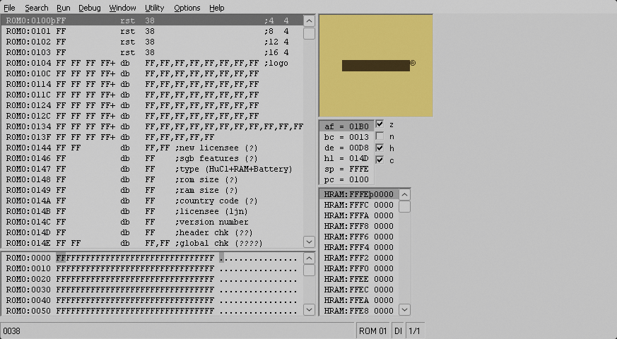
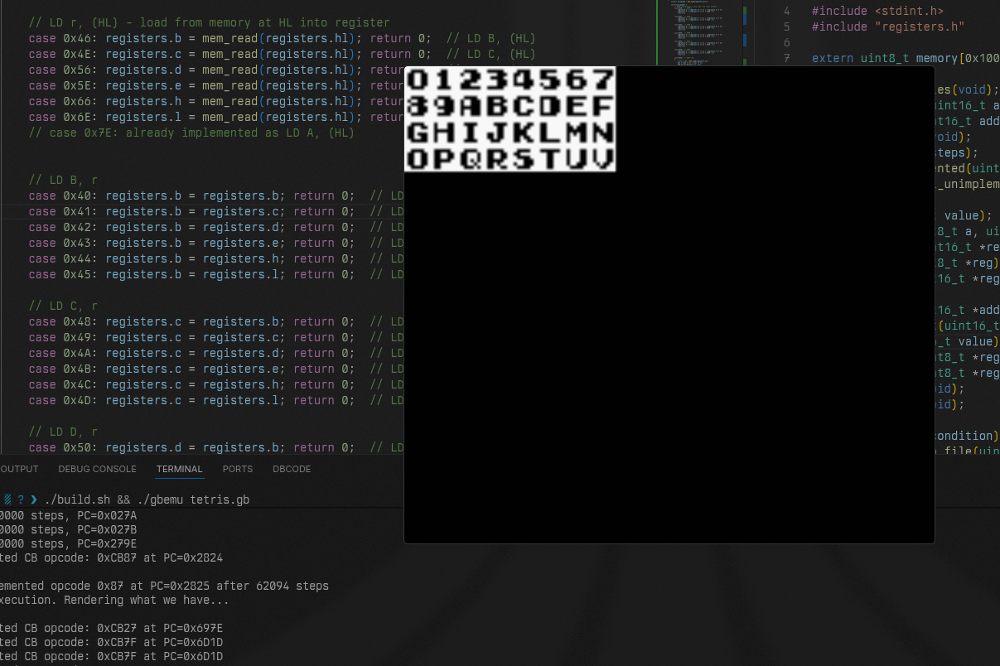
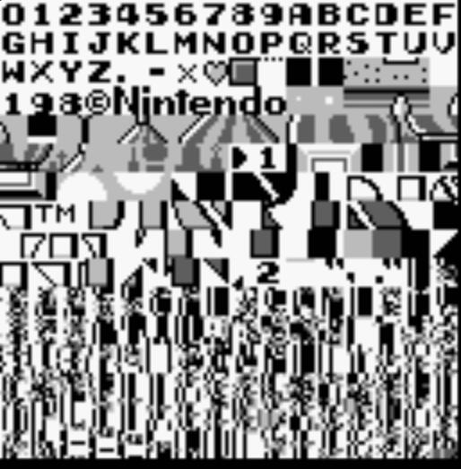
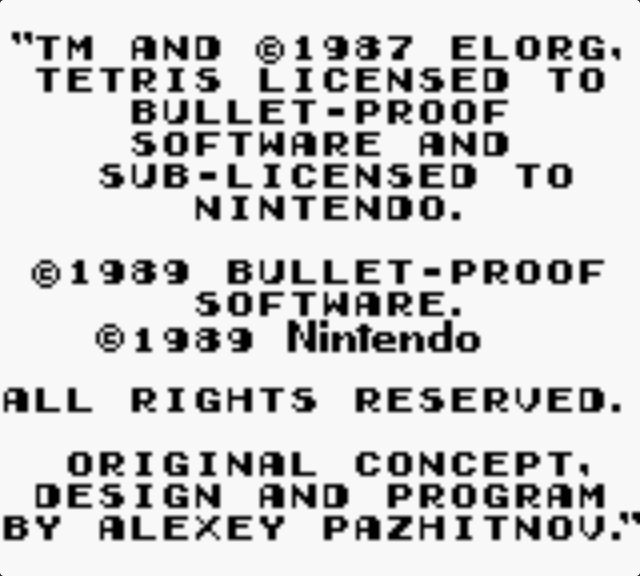
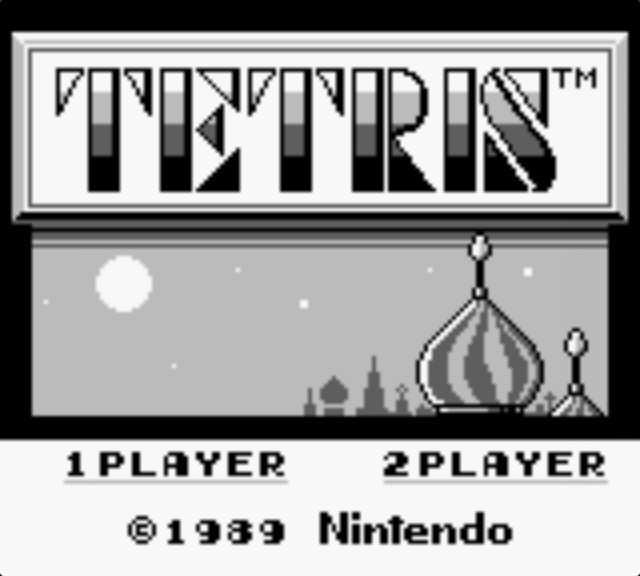
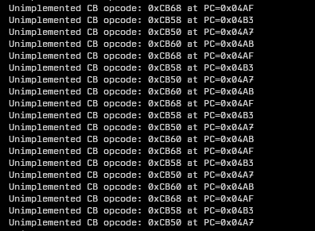

Alright now for fresh pair of eyes on this project! 

Now `NO$GMB` is great but it only supports Windows/DOS, no Linux support. Sucks for an arch user.
I don't want to be switching so I need to try wine.

## Wine
It worked out of the box.

damn

## Tilesets again.

I was getting stuck in a loop, found out that the loop is waiting to hear back from the LCD.
After add that to my memory. I need to add more opcodes..

After 174 OP codes I now have data in the ROM spat out. Okay for now enough lets get all of data.

## Maps

Now we to map these tiles according to the instructions.

After loading tile data into VRAM, the Game Boy uses a **tile map** at address 0x9800—a 32×32 grid where each byte is an index pointing to which tile should appear at that position.

After successfully rendering the copywrite screen, I discovered the game was stuck because it was waiting for **VBlank interrupts** to advance.

The Game Boy uses VBlank (triggered 60 times per second when the screen finishes drawing) as its main timing mechanism, and Tetris counts VBlanks to automatically progress after a few seconds. I implemented VBlank interrupt generation by detecting when the scanline counter transitions from line 143 to 144, then pushing the program counter onto the stack and jumping to the interrupt handler at address 0x0040, allowing the game to finally move past the copyright screen automatically!

Here I met my most dreaded enemy. More OP Codes

I'm gonna call it there for the day. I'll come back to that.